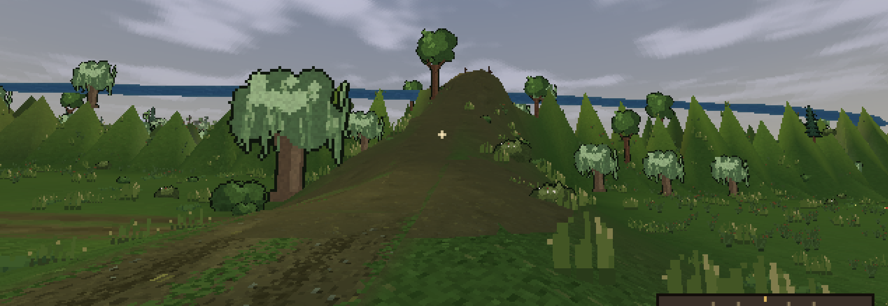
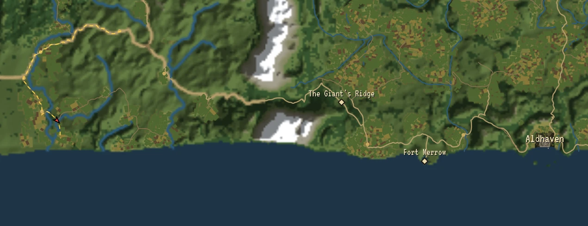
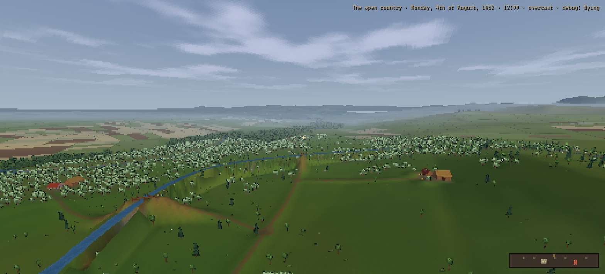

# Improvements for later

Things to improve, noted while playing. They are for the future: none of them is to be started without being asked, and the ideas under each are ideas, not decisions. Numbers stay fixed so an item can be named by its number; new ones go at the end.

Code references are as of the day an item was written down. Check them before building from them.

## Open

### 1. Kestrel Tower makes no sense (2026-11-12)
It reads as just a medium-sized tower in a valley. It needs a reason to be there and a form that shows it: it is meant to keep a high pass. Same trouble as item 16.

### 2. The Ninefold Stones are too small to feel remarkable (2026-11-12)
Make the stone circle bigger.

### 5. The main menu shows the version and recent changes (2026-11-12)
The title screen has no version and no list of what changed.

### 6. Pilgrim's Rise, the starting point, makes no sense (2026-11-12)
A crag north-east of the city walls (`src/03_terrain.js`). Its name and lore may be the user's call; the names are stand-ins (`docs/SETTING.md`).

### 7. A better name than Aldhaven, and a better subtitle (2026-11-13)
The title screen reads "Merrow Bay, 1652 / Aldhaven / ~ A Port and its Country ~" (`src/template.html`). Aldhaven is both the city and the game's title (page title, `dist/aldhaven.html`, the save keys `onecity_aldhaven_*`), so a rename touches all of these and the mapping of old saves in `src/12_main.js`. The user will want a say in the name.

### 9. The music mix (2026-11-13)
The plucked instruments (harp and pizzicato, Karplus-Strong plucks in `src/02_music.js`) are still too loud, and the default music volume (`settings.music`, 0.5 in `src/00_core.js`) is a bit too loud.

### 11. Halewood House feels in the middle of nowhere (2026-11-13)
It sits on its own ground near Corrinvale, with a 1 km axis of avenue, gardens and rides and nothing lived-in around it. The fix is more along and around it, not a shorter axis.

### 12. A phone layout for the survey screen (2026-11-18, put off by the user)
The iPad is fine both ways round. On phones (checked headless at 844×390 and 390×844, touch on):
- In portrait the field book (316 px wide) runs into the map's −, + and Close map buttons, and its ◂ fold button is hidden under −. Folded, its tab is under − and +, and the Debug panel lies on top of the field book.
- While sighting, the +, − and Bearing buttons cover the spyglass's lines of text.
- In landscape the field book runs over the help text, and the Debug panel only fits by scrolling.
- On the iPad in portrait, the round − button covers the end of the sighting hint.

Planned, not built: a layout for narrow screens (the field book below the map buttons and folded at first, the help text shortened or hidden, the spyglass buttons moved clear of the text). The general touch bar shrinking to 30 px in phone landscape was left out as not part of surveying.

### 13. The game's own cursor, and a way to deal with an unlocked pointer (2026-11-27)
The game has no cursor of its own: the system arrow, and a pointing hand on buttons (`index.html`). Looking with the mouse uses pointer lock (`requestLock`, `exitLock` and `onLockError` in `src/11_ui.js`, `pointerlockchange` in `src/12_main.js`). If the lock is let go during play (Esc, the window losing focus) the pause menu opens. If it can't be had at all on the first click, `enableFallback()` turns on dragging to look, and the arrow keys.

Still to ask: what should happen while the pointer is free (play on with a cursor, turn at the screen's edges, a clearer way back in), and whether the cursor is for menus and the map only or for play too. Touch on the iPad has no cursor and must not change.

### 14. Large-scale variety is too far apart, perhaps by half (2026-11-27)
Things at a very large wavelength, such as the regions (biomes), the distance between places worth seeing, and the mountains and the rise and fall of the land, are generally too far apart and could probably be cut in half. The settings today:
- `REGION.cell` is 5600 m (`src/03_regions.js`): a region is 15 to 60 minutes' walk across.
- The lie of the land (`wildRelief` in `src/03_terrain.js`): in the home country, uplands and lowland plains follow a field 2800 m across, ranges run along the zero lines of a field 2400 m across, and their massifs are built at 760 m and 410 m. The home country (20 × 20 km) is closed by mountains too steep to climb. Beyond it the uplands, ranges and crags are already drawn at 0.40 of that size (`RELIEF.k`) and the valleys at 0.72 (`RELIEF.kv`, kept wider so their sides don't become walls). Still to ask: whether the user means the home country, the land beyond, or both.
- Small places are tried once in each 700 m cell (`POI.HC`), and 42 % of the cells are tried at all, so they lie about 1 km apart (`src/03_poi.js`).
- Villages, hamlets and farmsteads come from the settlement plan (`src/03_settle.js`).

This is the same direction as making places denser without making them smaller: halve the spacing, keep the size of the whole. In the home country it would move hills, rivers, villages and places (the `LEGACY = 1` plan; the rivers follow the ground, so a change to the relief moves nearly everything), so there it needs the user's decision. Beyond it, change freely. Check with `tools/digest.py --diff` and `tools/endless.py`.

### 15. Fast travel stops too far from a landmark it finds (2026-11-27)
Travel stops the moment a landmark is found (`src/11_travel.js`, `Sites.update`), and a landmark is found from its `discR`, 200 to 520 m from its middle: Greywatch 240, the Ninefold Stones 200, Mirrormere 330, Kestrel Tower 260, Gullscar Light 260, Halewood House 520, the Giant's Ridge 300, Fort Merrow 330, a town its own size plus 260. At walking pace (3.9 m/s) that leaves one to two minutes still to walk. Small places stop you at 55 m, which is fine.

An idea: still find it at that distance (it goes on the map), but travel on to near it (its gate, or the point of the road nearest to it) before stopping.

### 16. Fort Merrow needs much more attention to detail, and it protects nothing (2026-11-27)
The fort (`src/03_sites_star.js`, `docs/FORT.md`) stands on a low point on the western shore of Merrow Bay, about 4.3 km west of Aldhaven, placed to command the roadstead, where four ships ride at anchor. What it guards doesn't read: it is not at the bay's mouth, a narrows, the entrance to the city's harbour or a river mouth, and an anchorage alone doesn't explain it.

Ideas: move it to where it visibly closes a passage, or give it something beside it worth guarding. Still to ask: which details look thin (walls, guns, the inside, people, the land round it). It is the same in every world and marked `S.quiet`, so the home rivers ignore it, but moving it still changes the home plan: check with `tools/digest.py --diff`.

### 17. Music starts abruptly, with no fade in or out (2026-11-27)
In `src/02_music.js` (`Music`) a new piece gets a fresh bus whose fade gain is already at 1, and its first notes sound 0.3 s after `start()`, so it comes in at full strength. The only fade is `fadeOut()`, with a time constant of 1.1 s (nearly silent after about 3 s). It runs when the mood changes, for example on entering a new place (the new piece then starts 3 s later), and when a piece has played to its end (then a pause of 80 to 200 s, or 2 s with pauses off). So a change of place cuts the music off in mid-phrase in about 3 s. Turning the music volume down to 0 fades it the same way. The old pieces (`Legacy`) start the same way.

Ideas: a fade-in on the bus at the start of each piece (several seconds), a longer fade-out on a change of place, and pieces that open quietly. Check by ear with `tools/music.py`.

### 18. The Giant's Ridge is two to three times longer than it needs to be (2026-11-27)
Keep its height, so it stays as spectacular as it is, and shorten mostly the parts that don't stand high. Today (`src/03_sites_ridge.js`, `docs/EMBANKMENT.md`, data in `docs/embankment_data.json`) the bank is 2000 m long, on a fixed line of 70 points from (-6614, -652) to (-7966, -2100), with the valley round it fixed too. How high it stands over the land beside it, from the south-east end:

| along the bank | 0–350 m | 350–560 m | 560–1500 m | 1500–1900 m | 1900–2000 m |
| --- | --- | --- | --- | --- | --- |
| height | 0 → 10 m | 10 → 15 m | 20 → 33 m | 18 → 10 m | 10 → 0 m |

So it stands 20 m or more for about 950 m, 15 m or more for about 1100 m and under 10 m for about 450 m in all. Two to three times shorter would be about 700 to 1000 m: cutting the low ends alone gets to about 1.1 km, so the high middle would get somewhat shorter too, or the valley's sides steeper or closer together, which means changing its fixed ground as well as its line. The ridge was cut from seed 0's west road and the home plan was redrawn round it, so a new line changes the home plan: check with `tools/digest.py --diff`, `tools/ridgewalk.py 0 1 2` and `tools/invariants.py`.

### 19. A new kind of place, after a fault in the generated country (2026-11-27)

The user found this where the country's generation went wrong. They find it very memorable and mysterious, and it is to be the template for a new place.

**What the user saw.** A dirt track runs straight into a tall, narrow hump of bare brown earth and up its face to two small posts on the top: the rails of a timber bridge. From the bridge a stream is seen flowing along the top of the land between steep green banks. In the first picture those banks are the row of steep, peaked green hills behind the hump, and the blue line above them along the horizon is the stream's water, seen edge-on.

**The user's idea.**
- The raised banks curve inward. That would be a natural place for an old earthen fortress, now used as the marketplace of a nearby village, or with several villages close by.
- The walls are jagged and peaked, and that is a really nice look to keep.
- It should be built away from the main map first, until the place and its immediate surroundings are built, look nice and feel authentic. Only then is it put back into the game world. (The user wrote "You were built away from the main map"; read here as "it should be built away from the main map".)

**Where it is.** Seed 0 (the artifact has no `?seed=`), in the country west of the home country (lattice cell -1, 1), about 17.5 km west of Aldhaven and 7 km beyond the home mountains. Found with a headless search on 2026-11-27:
- **The stream** is river 3 of that country, a tributary that joins river 0 (the larger river towards the coast) at (-17627, -104). Upstream it crosses a plateau with its water at 32 m, the land 0.5 m above it. Where the plateau ends, near (-17320, -879), the land falls to 14–18 m, but the water keeps its level: for 945 m, from (-17320, -879) to (-17611, -116), it runs up to 18 m above the land beside it (highest at (-17501, -659)). It curves west, then south, and drops about 12 m to river 0's level only at the join. Its banks are drawn as steep, jagged slopes from the land up to the water.
- **The two humps** are where two lanes cross it on timber bridges. A bridge's deck is set 1.6 to 5 m above the water (`deck` in `waysFromGen`, `src/03_wild.js`), so each lane climbs about 16 m on a bank of bare earth some 75 m long: lane 17 at (-17441, -754), deck at 33 m on land at 17.6 m (most likely the one in the user's picture, on their route), and lane 78 at (-17473, -577), deck at 32.3 m on land at 14.8 m.
- **The same fault elsewhere** (rivers more than 3 m above the land for over 150 m, in the same search): cell (-1, 1) river 5 near (-17589, -6876), 604 m long and up to 54 m high, and river 4 near (-17525, -5511), 313 m, 19 m; cell (-2, 1) rivers 4, 1 and 5 near (-26700, -950), 420–474 m long and 13–18 m high, where three streams meet. So the look can be studied in more than one place.

**What it means for the build.** The raised stream comes from the river's water level being kept while the land under it falls away, so today it exists only by chance and only in these spots. Fixing the river fault (in `src/03_water.js` or the land) would remove it from here, so the place should be made on purpose, as its own landmark or kind of place, before such a fix. The scripts used for the search and the pictures are in the session's scratchpad and not kept: the search reads `World.planBox`, each country's `ways.tracks` (with `T.h`), `ways.bridges` and `land.rivers` (`P`, `wl`, `w`) against `terrainRaw`.

### 20. Guards above all, and other people too, need clothing of their period (2026-11-27)
The game is set in 1652. Today (`LOOKS` and `drawHuman` in `src/01_textures.js`) the city's guard wears what a medieval guard would: a mail shirt, a red tabard with a gold cross, a round steel cap and a spear. The people come from `randomLook` and `lookByWealth` (`src/04_city.js`), built from parts such as shirt, trousers, boots, robe, hood, cape, apron and hat. The robe, hood and tabard read as medieval more than seventeenth-century. Fort Merrow's sentry, gunner and sergeant (`src/03_sites_star.js`) get only a hat, a red coat and breeches.

Ideas, for a town watch and a garrison of about 1650: a broad-brimmed felt hat or an open steel helmet (morion or cabasset), a buff leather coat, a sash, a bandolier of powder charges, breeches with stockings and shoes, a halberd or partisan for the watch and a musket for the garrison. Townsmen in doublet or long coat with a falling collar, breeches and stockings; women in bodice and skirt, with a white cap or coif, a collar or kerchief and an apron. The sprites are small, so each piece must read at a few pixels: a hat's brim, a collar, a sash. Any colours or badges meant to mark a city or a country tie in with the setting, which is the user's to decide (`docs/SETTING.md`).

## Done

- **3. The world should not end** (2026-11-12): the world goes on as a lattice of countries, with roads running out of each. Merged in PR #3, notes in `docs/ENDLESS.md`.
- **4. Elder Scrolls names and lore replaced** (2026-11-12): stand-in names, listed in `docs/SETTING.md`.
- **8. Finding a village no longer stops fast travel** (2026-11-14): merged in PR #2.
- **10. More kinds of road** (2026-11-14): high roads, cart tracks, lanes, green lanes and hollow ways by the traffic they carry. Merged in PR #2.
